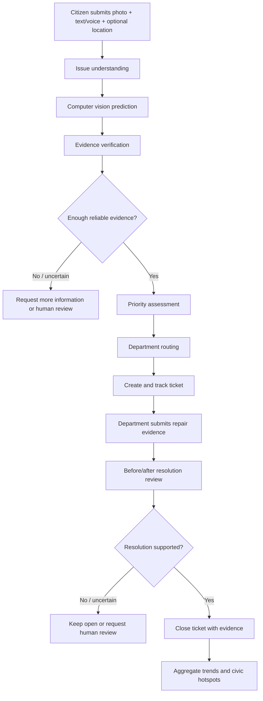
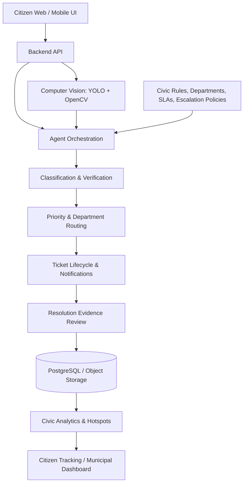

::: {align="center"}
# 🏙️ FixMyCity AI

### From Civic Complaints to Verified Action.

**AI-powered civic issue detection, prioritization, and resolution
coordination**

[](https://www.python.org/)
[](https://docs.ultralytics.com/)
[](#-computer-vision-dataset)
[](#-testing-and-validation)
[](#-project-status)

**Report → Understand → Verify → Prioritize → Route → Track → Resolve →
Learn**

*A citizen-first civic issue workflow powered by computer vision and a
planned multi-agent coordination layer.*
:::

------------------------------------------------------------------------

## ✨ The idea

Cities face everyday infrastructure problems---potholes, garbage
accumulation, broken streetlights, water leakage, and drainage hazards.
Reporting can be fragmented, complaints may be misclassified or
duplicated, and citizens may struggle to see what happens after
submitting a report.

**FixMyCity AI** is designed to turn a citizen's photo, description,
voice report, and optional location into a structured, trackable civic
issue. Its computer-vision component detects supported issue categories;
a broader agentic workflow is designed to verify evidence, estimate
urgency, route the complaint to the appropriate department, track
progress, and check resolution evidence.

> **FixMyCity AI doesn't just collect complaints. It understands the
> problem, decides what needs attention first, sends it to the right
> place, and follows it until resolution.**

> **Project honesty note:** This repository currently includes the
> unified computer-vision dataset pipeline, dataset validation tests,
> and a locally trained YOLOv8n model. The full citizen application,
> multi-agent orchestration, municipal integrations, ticket lifecycle,
> live map dashboard, and before/after resolution workflow are project
> goals---not claims that every component is already implemented.

## 📌 Contents

-   [Problem and solution](#-problem-and-solution)
-   [What makes it agentic](#-what-makes-it-agentic)
-   [End-to-end workflow](#-end-to-end-workflow)
-   [Supported computer-vision
    classes](#-supported-computer-vision-classes)
-   [Computer-vision dataset](#-computer-vision-dataset)
-   [Model evaluation](#-model-evaluation)
-   [Repository structure](#-repository-structure)
-   [Quick start](#-quick-start)
-   [Run inference](#-run-inference)
-   [Dataset pipeline](#-dataset-pipeline)
-   [System architecture](#-system-architecture)
-   [Team responsibilities](#-team-responsibilities)
-   [Testing and validation](#-testing-and-validation)
-   [Limitations and responsible use](#-limitations-and-responsible-use)
-   [Roadmap](#-roadmap)
-   [Contributing](#-contributing)
-   [Acknowledgements and data
    provenance](#-acknowledgements-and-data-provenance)

## 🎯 Problem and solution

### The problem

Civic issues can be difficult to report and coordinate because:

-   Reports arrive through disconnected channels.
-   Images and descriptions may be ambiguous or incomplete.
-   Similar reports can be submitted for the same issue.
-   Urgency and safety risk may not be consistently assessed.
-   Complaints can reach the wrong department.
-   Citizens may lack transparent status updates.
-   A ticket may be marked resolved without clear evidence of the
    repair.

### The proposed solution

FixMyCity AI aims to provide one workflow for:

1.  **Understand** a report from an image and description.
2.  **Verify** evidence quality and identify potential duplicate or
    suspicious reports.
3.  **Prioritize** issues using severity, safety risk, recurrence, and
    affected people.
4.  **Route** each issue to the responsible municipal or utility
    department.
5.  **Track** a ticket and its status.
6.  **Verify resolution** using before-and-after evidence.
7.  **Learn** from recurring issues and geographic hotspots.

## 🤖 What makes it agentic?

Rather than relying on one generic chatbot, the proposed platform
divides the workflow into specialized agents with explicit
responsibilities and structured outputs.

  -----------------------------------------------------------------------
  Agent                   Responsibility          Example output
  ----------------------- ----------------------- -----------------------
  Classification          Interpret the complaint `pothole`
                          and predicted issue     
                          category                

  Verification            Review evidence         `verified` /
                          quality, consistency,   `needs_review`
                          and possible duplicates 

  Priority                Estimate urgency from   `high`, with an
                          severity and safety     explanation
                          context                 

  Department Routing      Select the relevant     `Roads Department`
                          department using        
                          configured rules        

  Tracking / Action       Create and update a     Ticket ID and current
                          complaint ticket        status

  Resolution              Compare repair evidence `resolved` /
                          and flag uncertain      `manual_review`
                          outcomes                

  Civic Intelligence      Aggregate reports to    Hotspot or trend
                          identify recurring      summary
                          problems                
  -----------------------------------------------------------------------

These are the intended workflow responsibilities. Agent outputs should
be validated, grounded in available evidence, and subject to human
review where needed. The computer-vision model alone does not implement
the entire agentic workflow.

## 🔄 End-to-end workflow



### Example scenario

A citizen uploads a photo and reports: *"There is a large pothole near
the college gate; two bikes have fallen."*

1.  The vision model predicts the pothole category and returns bounding
    boxes and confidence scores.
2.  Verification checks whether the evidence is usable and whether a
    duplicate may exist.
3.  Priority logic considers the reported safety risk and available
    evidence.
4.  Routing rules suggest the relevant road-maintenance department.
5.  A ticket is created and its status is displayed.
6.  Repair evidence is submitted and reviewed before closure.

The example illustrates the intended end-to-end experience; the full
flow depends on integration of the separate agents and application
components.

## 🧠 Supported computer-vision classes

The current unified YOLO dataset defines five target classes:

    Class ID Class name        Example civic concern
  ---------- ----------------- --------------------------------
           0 `pothole`         Road surface damage
           1 `garbage`         Accumulated waste
           2 `streetlight`     Streetlight-related issue
           3 `water_leakage`   Visible water leakage
           4 `drainage`        Open manhole / drainage hazard

**Important:** A detection indicates a visual match to a dataset
category. It does not by itself prove severity, exact location,
ownership, a service outage, or that a municipal department is
responsible. Those decisions need additional evidence and rules.

## 🗂️ Computer-vision dataset

The project combines source datasets into a single YOLO-format dataset
using a reproducible conversion and validation pipeline.

### Current dataset snapshot

  Split             Images
  ------------ -----------
  Train              4,320
  Validation           901
  Test                 866
  **Total**      **6,087**

The last recorded validation report indicated **6,087 images**, **6,087
corresponding label files**, **0 errors**, and **144 warnings**. The
warnings were reviewed as annotation-quality signals; they should not be
represented as zero concerns. Empty-label images are intentionally
allowed as background/negative examples.

### Unified dataset paths

``` text
datasets/
└── FixMyCity_Datasets/
    ├── raw/
    └── processed/
        └── fixmycity_yolo/
            ├── data.yaml
            ├── images/
            │   ├── train/
            │   ├── val/
            │   └── test/
            └── labels/
                ├── train/
                ├── val/
                └── test/
```

The generated dataset is kept out of Git because it is large. The
directory layout above describes the expected local dataset structure;
source archives and generated outputs may differ by machine.

### Dataset engineering features

-   Conversion of source annotations to YOLO format.
-   Unified mapping to five civic issue classes.
-   Train/validation/test split handling.
-   Bounding-box validity checks.
-   Dataset and label count validation.
-   Reporting of invalid annotations and suspicious full-image boxes.
-   Support for empty label files as negative/background examples.
-   Source metadata and provenance notes in the dataset configuration.
-   Unit tests for parsing, bounding boxes, mappings, and validation
    status.

### Full-image-box policy

The pipeline includes a configurable policy to convert selected
near-full-image boxes into negative examples by removing those
annotations while retaining the image. This is intended to prevent
questionable full-frame annotations from teaching the detector that the
entire scene is an object.

This policy must be used carefully: a full-frame box can sometimes be
legitimate. Review the audit report and source annotations before
rebuilding the dataset. The currently trained checkpoint was evaluated
on the previously generated dataset; changing the policy does not
automatically retrain or improve that checkpoint.

## 📊 Model evaluation

The current locally saved model is a **YOLOv8n model trained with the
AdamW optimizer**, using an image size of 640 pixels. The following are
the last recorded validation results for that checkpoint.

### Overall validation metrics

  Metric                              Result
  --------------------------- --------------
  Precision                            77.1%
  Recall                               61.4%
  mAP@50                               71.6%
  mAP@50--95                           41.4%
  Validation inference time     8.5 ms/image

The inference time is from one recorded validation run and is
hardware/configuration dependent. It is not an end-to-end API or
application latency guarantee.

### Per-class results

  Class             Precision   Recall   mAP@50   mAP@50--95
  --------------- ----------- -------- -------- ------------
  Pothole               78.7%    64.7%    72.3%        45.2%
  Garbage               80.2%    47.7%    62.5%        28.5%
  Streetlight           73.9%    53.3%    62.3%        33.3%
  Water leakage         82.8%    85.9%    91.2%        65.6%
  Drainage              70.0%    55.6%    69.5%        34.7%

### Interpreting these results

-   **Water leakage** is the strongest class in this evaluation.
-   **Garbage and streetlight** recall and localization quality need
    further work.
-   Precision and recall measure different failure modes; a single
    number does not describe all deployment behavior.
-   mAP is not the same as classification accuracy.
-   These are validation results, not a guarantee of performance on
    every city, camera, lighting condition, or real-world report.

### Current model checkpoint

Expected local path:

``` text
runs/fixmycity/yolov8n_adamw_v1/weights/best.pt
```

Model weights and training outputs are ignored by Git and are **not
included in this repository snapshot**. Anyone cloning the repository
must obtain the checkpoint through an approved project artifact-sharing
process or train a new model. Do not assume the checkpoint can be
downloaded from GitHub.

## 🧱 Repository structure

``` text
Fix My city/
├── .gitignore
├── README.md
├── requirements.txt
├── LICENSE
├── ml/
│   ├── README.md
│   ├── configs/
│   │   └── classes.yaml
│   ├── notebooks/
│   └── src/
├── datasets/
│   └── README.md
├── scripts/
│   └── datasets/
│       ├── build_unified.py
│       ├── config.py
│       ├── convert.py
│       └── validate.py
├── tests/
│   └── test_dataset_pipeline.py
└── runs/  # local outputs; ignored by Git
```

This is a high-level view of the project's core files, not an exhaustive
listing of every local file. Some directories may be empty or contain
additional files depending on the current checkout.

## 🚀 Quick start

### Requirements

-   Git
-   Python 3.12 or a compatible Python version supported by the
    dependencies
-   Windows PowerShell commands below are written for the current
    Windows development setup
-   A trained `.pt` checkpoint for inference
-   GPU is optional for inference; CPU performance will differ

### 1. Clone the repository

``` powershell
git clone https://github.com/HackIndiaXYZ/hackindia-ai-cybertech-hackathon-2026-hackathon-survivers.git
cd "hackindia-ai-cybertech-hackathon-2026-hackathon-survivers"
```

If you already have the repository locally, skip cloning and open the
existing project directory.

### 2. Create and activate a virtual environment

``` powershell
py -3.12 -m venv .venv
.\.venv\Scripts\Activate.ps1
python -m pip install --upgrade pip
```

If PowerShell blocks activation in the current terminal, you can use a
process-scoped policy:

``` powershell
Set-ExecutionPolicy -Scope Process -ExecutionPolicy RemoteSigned
.\.venv\Scripts\Activate.ps1
```

### 3. Install dependencies

``` powershell
pip install -r requirements.txt
```

If the repository's dependency file does not include the required
inference packages, install the compatible Ultralytics and PyTorch
builds for your machine using their official installation instructions.
GPU support depends on your driver, CUDA-compatible PyTorch build, and
hardware.

### 4. Obtain local assets

The dataset and model checkpoint are intentionally not committed. Place
them at the documented local paths or update the configuration/command
to match your paths.

Expected dataset configuration:

``` text
datasets/FixMyCity_Datasets/processed/fixmycity_yolo/data.yaml
```

Expected checkpoint:

``` text
runs/fixmycity/yolov8n_adamw_v1/weights/best.pt
```

Do not download untrusted model files or expose credentials in the
repository.

## 🔍 Run inference

A reusable CLI inference module is a planned integration deliverable. If
`ml/src/predict.py` is present in your current checkout, use the command
below. Otherwise, implement and test the inference script before using
it.

``` powershell
.\.venv\Scripts\python ml\src\predict.py `
  --source "path\to\test_image.jpg" `
  --conf 0.25 `
  --imgsz 640
```

The intended behavior is to load the checkpoint, detect supported
categories, display confidence scores and bounding boxes, and save an
annotated image. Confirm the exact arguments and output directory
against the implementation in your checkout.

For a quick manual check when Ultralytics is installed and the
checkpoint exists, this direct command can test a single image:

``` powershell
.\.venv\Scripts\python -c "from ultralytics import YOLO; model=YOLO(r'runs\fixmycity\yolov8n_adamw_v1\weights\best.pt'); model.predict(source=r'path\to\test_image.jpg', imgsz=640, conf=0.25, save=True, project=r'runs\fixmycity', name='manual_prediction', exist_ok=True)"
```

Replace `path\to\test_image.jpg` with a real image path. This direct
command uses Ultralytics' prediction API and does not require a custom
CLI.

## 🛠️ Dataset pipeline

The dataset pipeline code is version controlled. The large generated
dataset remains local.

Run the dataset pipeline tests:

``` powershell
.\.venv\Scripts\python -m unittest discover tests -v
```

To inspect the source scripts and their supported command-line options:

``` powershell
Get-Content scripts\datasets\README.md
Get-Content datasets\README.md
python scripts\datasets\build_unified.py --help
python scripts\datasets\validate.py --help
```

Use the actual options shown by each script's `--help` output; do not
run a rebuild on the only working dataset before reviewing the
configuration and keeping a backup.

## 🏗️ System architecture

The intended architecture separates the user experience, AI models,
agents, knowledge, backend, storage, and analytics.



### Recommended stack

  -----------------------------------------------------------------------
  Layer                   Suggested technology    Purpose
  ----------------------- ----------------------- -----------------------
  Frontend                Next.js, React,         Citizen reporting and
                          Tailwind CSS            dashboards

  Backend                 Python, FastAPI         APIs and workflow
                                                  services

  Agent orchestration     LangGraph, LangChain    Multi-agent
                                                  coordination

  LLM                     Gemini or               Structured reasoning
                          OpenAI-compatible API   and explanations

  Computer vision         YOLO/Ultralytics,       Civic issue detection
                          OpenCV                  

  Speech                  Whisper or a            Voice complaints
                          speech-to-text API      

  OCR                     PaddleOCR or Tesseract  Text extraction where
                                                  needed

  Database                PostgreSQL, PostGIS     Tickets and geospatial
                                                  queries

  Vector search           ChromaDB or FAISS       Civic knowledge
                                                  retrieval

  Cache/queues            Redis                   Background tasks and
                                                  status updates

  Maps                    Leaflet/OpenStreetMap   Location and hotspot
                          or Mapbox               display

  Development             Git, GitHub, Docker     Collaboration and
                                                  reproducibility
  -----------------------------------------------------------------------

These are recommended architectural technologies, not a statement that
each one is already integrated in the repository.

## 👥 Team responsibilities

  -----------------------------------------------------------------------
  Role                                Responsibilities
  ----------------------------------- -----------------------------------
  **1. AI/ML & Computer Vision**      Dataset curation, issue detection,
                                      evaluation, severity estimation,
                                      duplicate/similarity analysis, and
                                      repair evidence review

  **2. AI Agents / LLM / RAG**        Agent orchestration, structured
                                      outputs, civic knowledge base,
                                      routing rules, guardrails, and
                                      human review

  **3. Backend / Database /           Report APIs, ticket lifecycle,
  Geospatial**                        department assignment, SLA
                                      tracking, notifications, and map
                                      queries

  **4. Frontend / Product /           Citizen reporting UI, AI result
  Dashboard**                         page, municipal dashboard, ticket
                                      status, maps, and before/after
                                      review screens
  -----------------------------------------------------------------------

## 🧪 Testing and validation

The latest full test run passed **41 tests and 5 subtests**. Run the
tests again after making changes:

``` powershell
.\.venv\Scripts\python -m unittest discover tests -v
```

The suite covers dataset configuration and validation, image inference input handling,
preliminary severity rules, duplicate-image candidate detection, and repair-evidence handling.

See [the ML pipeline documentation](ml/README.md) for module usage, examples, and limitations.

Additional recommended tests for a complete product include:

-   Model inference on valid, corrupted, and unsupported image files.
-   Empty-detection and low-confidence cases.
-   API request validation and file-size limits.
-   Duplicate-report matching quality.
-   Department-routing rules and fallback behavior.
-   Priority decisions with a human-review path.
-   Before/after verification under changes in lighting, viewpoint, or
    weather.
-   End-to-end ticket creation, updates, and closure.
-   Geolocation privacy and authorization checks.

## ⚠️ Limitations and responsible use

-   **Prototype, not a municipal authority:** AI outputs should
    support---not replace---official inspection and decision-making.
-   **No guaranteed detection:** The model can miss issues or produce
    false positives.
-   **Severity is not automatically established by detection:** A
    bounding box alone does not measure danger, cost, or repair urgency.
-   **Location needs independent validation:** Image content alone may
    not establish exact GPS coordinates.
-   **Duplicates need more than class matching:** Similar-looking issues
    may be separate incidents.
-   **Resolution needs evidence:** A predicted image difference is not
    definitive proof that a repair is complete.
-   **Human review matters:** Uncertain, high-impact, or disputed
    reports should have an escalation path.
-   **Protect citizen privacy:** Avoid exposing faces, vehicle plates,
    precise home locations, personal details, or API credentials
    unnecessarily.
-   **Dataset provenance matters:** Respect the license and terms of
    every source dataset before redistributing data or model artifacts.

## 🗺️ Roadmap

### Phase 1 --- Computer-vision foundation

-   [x] Define the five-class civic issue taxonomy.
-   [x] Build a unified YOLO-format dataset pipeline.
-   [x] Validate dataset files and annotations.
-   [x] Train a baseline YOLOv8n model.
-   [x] Record per-class validation metrics.
-   [x] Add tests for dataset parsing and full-image-box policy.
-   [ ] Package a tested, documented inference CLI.
-   [ ] Collect representative failure cases and improve weak classes.

### Phase 2 --- Agentic workflow

-   [ ] Implement structured classification and verification outputs.
-   [ ] Add severity scoring with clear reasons.
-   [ ] Add configurable department-routing rules.
-   [ ] Add duplicate-report review.
-   [ ] Integrate a civic knowledge base and escalation policies.
-   [ ] Add human approval for uncertain decisions.

### Phase 3 --- Application and tracking

-   [ ] Connect the citizen reporting UI to backend APIs.
-   [ ] Implement ticket creation and status tracking.
-   [ ] Add a department dashboard and map.
-   [ ] Add notifications and SLA tracking.
-   [ ] Implement before/after resolution review.

### Phase 4 --- Civic intelligence

-   [ ] Identify recurring issue hotspots.
-   [ ] Add neighborhood-level trend analysis.
-   [ ] Evaluate model performance on local, real-world imagery.
-   [ ] Explore multilingual voice reporting.
-   [ ] Integrate official municipal systems only with appropriate
    authorization.

## 📚 Acknowledgements and data provenance

The unified dataset configuration records the source datasets and
class-mapping decisions used by the project, including sources for
potholes, garbage, streetlights, water leakage, and
open-manhole/drainage hazards.

Before redistributing the processed dataset, source annotations, or
trained weights, review each source's license and any additional
platform terms. Attribution and redistribution permissions may differ
between sources. Keep source metadata and transformation decisions
documented so that the dataset can be audited and reproduced.

## 🤝 Contributing

Contributions should be small, testable, and documented.

1.  Create a focused branch for the change.
2.  Keep raw datasets, model weights, secrets, and generated outputs out
    of Git.
3.  Add or update unit tests when changing dataset parsing, class
    mappings, or annotation policies.
4.  Run the test suite before submitting a change.
5.  Document dataset sources, licensing, and configuration changes.
6.  Do not claim performance improvements without a comparable
    evaluation.

Example:

``` powershell
git checkout -b feature/your-change
.\.venv\Scripts\python -m unittest discover tests -v
git diff --check
```

## 📄 License

The repository contains a `LICENSE` file; consult it for the project's
code license. Dataset and model licenses may differ from the repository
license and must be checked separately.

------------------------------------------------------------------------

::: {align="center"}
### 🌆 A better way to report. A clearer path to resolve.

**FixMyCity AI --- turning civic signals into accountable action.**

Built as a hackathon prototype with a focus on transparent workflows,
evidence, and practical civic impact.
:::
